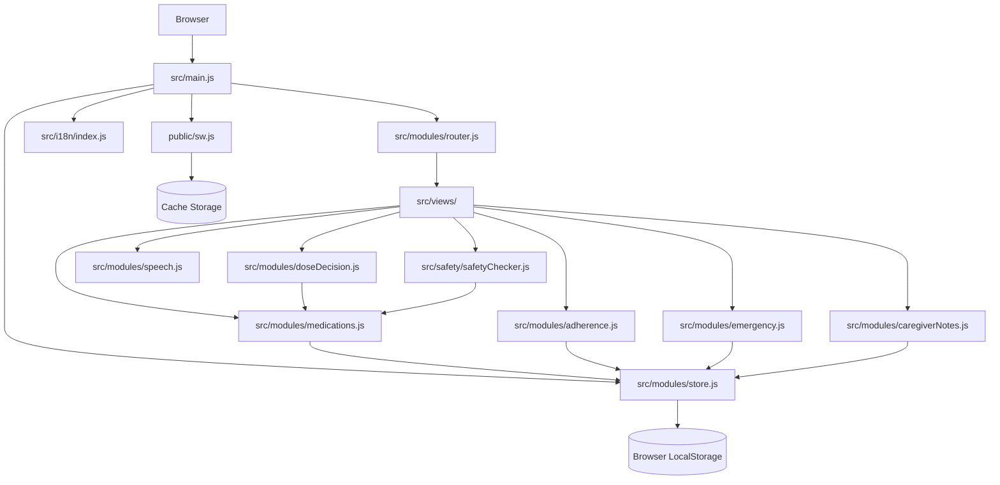

# Architecture

## Application structure

The repository is a Vite application with a small vanilla-JavaScript SPA.
The relevant application tree is:

```text
Niramaya/
├── index.html
├── package.json
├── vite.config.js
├── public/
│   ├── manifest.json
│   ├── sw.js
│   ├── favicon.svg
│   ├── icons.svg
│   └── icons/
│       ├── icon-192.svg
│       └── icon-512.svg
└── src/
    ├── main.js
    ├── style.css
    ├── components/
    │   ├── modal.js
    │   └── toast.js
    ├── i18n/
    │   ├── en.js
    │   ├── hi.js
    │   ├── index.js
    │   └── kn.js
    ├── modules/
    │   ├── adherence.js
    │   ├── caregiverAuth.js
    │   ├── caregiverNotes.js
    │   ├── doseDecision.js
    │   ├── emergency.js
    │   ├── medications.js
    │   ├── router.js
    │   ├── speech.js
    │   └── store.js
    ├── safety/
    │   └── safetyChecker.js
    ├── views/
    │   ├── caregiver.js
    │   ├── doseDecision.js
    │   ├── emergency.js
    │   ├── safetyChecker.js
    │   ├── senior.js
    │   └── settings.js
    └── tests/
        ├── adherence.test.js
        ├── doseDecision.test.js
        ├── emergency.test.js
        ├── i18n.test.js
        ├── medications.test.js
        ├── router.test.js
        ├── safetyChecker.test.js
        └── store.test.js
```

`src/assets/` also contains the Vite starter assets and `hero.png`; the
application UI does not use them.

## Modules and responsibilities

- `main.js` bootstraps the store and locale, builds the shell, registers the
  History API routes, and registers `/sw.js`.
- `router.js` owns the frozen route table, clean-path navigation, popstate
  rendering, internal-link interception, and legacy hash redirects.
- `store.js` is the LocalStorage wrapper, schema initializer, backup exporter,
  importer, and corruption/quota error boundary.
- `medications.js` owns medication validation, CRUD, schedule calculation, dose
  logging, duplicate prevention, soft deletion, and correction audit entries.
- `doseDecision.js` evaluates saved clinician instructions and returns stable
  decision states. It does not generate medical advice.
- `adherence.js` calculates the seven-day CareCircle metrics and missed-dose
  history.
- `caregiverAuth.js` provides the optional local PIN barrier; it documents that
  this is not high-security authentication.
- `caregiverNotes.js` stores caregiver observations.
- `emergency.js` validates and stores the Emergency Snapshot and synchronizes
  active medication details for display.
- `safetyChecker.js` is a pure record-quality checker. It returns stable
  category, severity, certainty, and translation-key codes.
- `speech.js` provides browser text-to-speech using the active locale.
- `i18n/index.js` provides `t()`, locale persistence, fallback lookup, and the
  `html[lang]` update. The locale catalogs are `en.js`, `hi.js`, and `kn.js`.
- `modal.js` and `toast.js` provide shared dialog and notification behavior.
- `views/` turns module results into the Senior Mode, DoseDecision, CareCircle,
  Emergency, Safety Check, and Settings screens.

### Route table

| Path | View |
| --- | --- |
| `/` | Senior Mode |
| `/missed-dose` | Missed Dose |
| `/caregiver` | CareCircle |
| `/emergency` | Emergency Snapshot |
| `/safety` | Safety Check |
| `/how-to-use` | How to Use |
| `/settings` | Settings |

The router uses `history.pushState()` and `popstate`, preserves query
parameters, and redirects legacy hash bookmarks such as `/#/senior` with
`history.replaceState()`. Unknown non-asset paths render the translated
not-found view. Vercel rewrites application paths to `index.html`; the service
worker serves the cached `/` shell for known navigation paths when offline.

## Data flow



## LocalStorage architecture

`src/modules/store.js` uses schema version `1` and keys with the `nm_` prefix:

| Key | Contents |
| --- | --- |
| `nm_schema_version` | Numeric schema version |
| `nm_medications` | Medication records, including name, dosage, unit, active ingredient, frequency, times, instructions, clinician instructions, dates, and deletion state |
| `nm_dose_logs` | Dose records and timestamps |
| `nm_profile` | Patient profile name, legacy language/senior-mode fields, and PIN field |
| `nm_emergency` | Emergency Snapshot fields, contacts, allergies, conditions, clinician details, notes, and update time |
| `nm_caregiver` | Caregiver PIN configuration and hash |
| `nm_settings` | Active language, Senior Mode, and font-size setting |
| `nm_caregiver_notes` | Timestamped caregiver observations |
| `nm_dose_audit_logs` | Correction audit entries for accidental dose records |

`initStore()` initializes absent keys and updates the schema marker. `getStore()`
parses JSON and replaces corrupted values with the corresponding default when
one exists. `setStore()` catches write failures, including quota failures, and
returns `false`. `exportData()` and `importData()` use the same keys and schema
version. `clearStore()` removes only keys beginning with `nm_`.

## DoseDecision workflow

The DoseDecision view reads a selected active medication and today’s dose logs,
then calls `evaluateMissedDose()` with the scheduled time, remembered time, and
whether the current or subsequent dose was recorded. The engine returns one of
the stable states in `DECISION_STATES`: verified instructions, no advice,
partial instructions, conflicting instructions, already recorded, or unknown
medication. The view maps those states to translated presentation text. It
never instructs the user to take a dose autonomously.

## Caregiver workflow

The Caregiver route checks the optional PIN barrier. Once unlocked, it reads
active and historical medication records, dose logs, audit logs, and caregiver
notes. `calculateSevenDayAdherence()` excludes future doses, computes the
adherence summary, and supplies the calendar and medication breakdown. Notes
can be added, edited, and deleted. The report can be sent to the browser print
dialog.

## Emergency Snapshot workflow

The Emergency route reads `getEmergencySnapshot()`, which combines the saved
emergency record with the current active medication list. The edit modal
validates the patient name and entered phone numbers before
`saveEmergencySnapshot()` writes the record. The patient name is also
synchronized to `nm_profile`. The screen can call the saved emergency contact
through a `tel:` link and can be printed.

## Safety Checker workflow

`checkMedications()` receives active medication records and does not mutate
them or access the DOM. It checks incomplete records, dosage and clinician
instruction omissions, duplicate records, explicit duplicate active
ingredients, schedule conflicts, and medicines scheduled at the same time.
The view translates the returned keys with `t()`, shows severity and
certainty, supports severity filtering outside Senior Mode, and opens the
existing medication editor for review. It does not check drug interactions.

## Internationalization

Supported locales are `en`, `hi`, and `kn`, with English as the default and
fallback. `t(key, params)` looks up the selected catalog, then English, then
returns the key. It interpolates `{name}`-style placeholders. Locale changes
persist to `nm_settings` and `nm_profile`, update `document.documentElement.lang`,
announce through the live region, and rerender the current route. Locale-aware
date, time, and number formatting uses `Intl` in the views.

## PWA and offline architecture

`public/manifest.json` declares the standalone app, `/` start URL, theme and
background colors, and 192px and 512px SVG icons. `main.js` registers
`/sw.js` with scope `/`.

The service worker uses cache version `niramaya-v5`. During installation it
caches `/`, the manifest, the two declared icons, and same-origin assets
discovered in the built HTML. Other same-origin GET responses, including
lazy-loaded view chunks, are cached at runtime. Failed same-origin requests
fall back to the cached `/` response. Activation deletes older cache versions
and claims clients.
